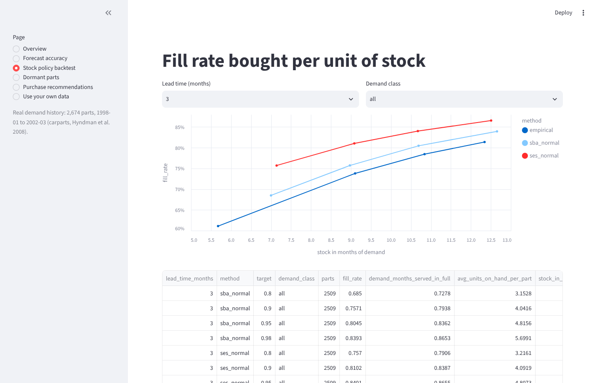
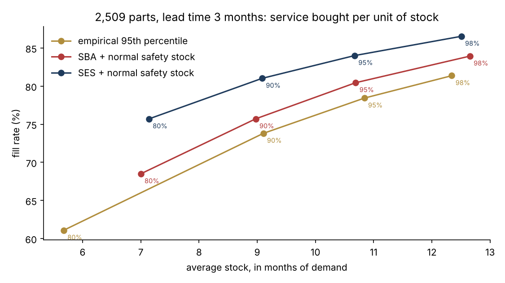
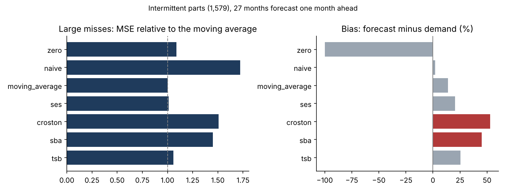

# Component stock cockpit

[](https://github.com/Abderrahmane-BOULAMI/component-stock-cockpit/actions/workflows/tests.yml)

In low-volume, high-mix industries, most parts are slow movers: months without any demand, then an order of a few units. Electronic components are a typical case. Stock levels set with textbook formulas either run out or pile up. This project takes a real demand history of 2,674 slow-moving parts over 51 months and answers the questions a supply chain team asks:

1. **What kind of demand is this?** Each part is classified (smooth, erratic, intermittent, lumpy) with the Syntetos-Boylan method.
2. **Which forecast can we trust?** Seven methods, including Croston and its corrections, are tested month by month on data they have not seen.
3. **How much stock does a service level really cost?** Three ways of setting the order-up-to level are simulated on the real history, with a lead time of 1 or 3 months.
4. **What should we buy now, and what should we stop buying?** A recommendation per part: order-up-to level, proposed order, and flags for the parts that need a human decision.



## The data

`carparts`: monthly sales of 2,674 slow-moving car spare parts, January 1998 to March 2002, from Hyndman, Koehler, Ord and Snyder, *Forecasting with exponential smoothing* (Springer, 2008). These are car parts, not electronic components; they are used because they are one of the few real, public histories of intermittent demand at this scale. 75% of the observed part-months have zero demand, and no part sells more than 52 units in a month. The 165 parts whose history stops before March 2002 are left out of the backtests, which use the other 2,509.

## Findings

1. **Almost every part is intermittent or lumpy.** On the full history, 2,294 parts are intermittent and 347 lumpy; only 3 are smooth and 30 have fewer than two demands. A forecasting approach built for regular demand does not apply here.

2. **Demand fell every year.** From 1,553 units a month in 1998 to 1,099 in 2001 (-29%) and 958 in the first quarter of 2002. Every method that looks at the past forecasts too high, and stock builds up unless the policy follows the decline.

3. **Croston and SBA, the textbook methods for intermittent demand, did worse than a moving average here.** On the 1,579 intermittent parts, forecast one month ahead over 27 months:

   | Method | MSE relative to the 12-month moving average | Bias |
   |---|---|---|
   | 12-month moving average | 1.00 | +14% |
   | Simple exponential smoothing | 1.01 | +20% |
   | TSB | 1.06 | +26% |
   | Always zero | 1.09 | -100% |
   | SBA | 1.45 | +45% |
   | Croston | 1.51 | +53% |
   | Last month's demand | 1.72 | +2% |

   Croston and SBA update the demand size and interval only when a demand occurs, so they followed the decline too slowly and over-forecast by about half. The table also shows a classic trap: forecasting zero gives the best mean absolute error (1.04 against 1.43 for the moving average, scaled), because most months are zero. A method chosen on that measure would never trigger an order.

4. **No policy reached 95% fill rate, and the formula's "95%" is not the fill rate you get.** With a 3-month lead time and the safety stock set for 95%:

   | Order-up-to level | Fill rate | Average stock |
   |---|---|---|
   | SES forecast + normal safety stock | 84.0% | 10.7 months of demand |
   | SBA forecast + normal safety stock | 80.5% | 10.7 months |
   | Empirical 95th percentile of past demand | 78.4% | 10.8 months |

   For the same stock, exponential smoothing gave 3.5 points more fill rate than SBA. Raising the target to 98% lifted it to 86.5% for 12.5 months of stock. The gap comes mostly from the 660 parts that had fewer than two demands in their first two years: with almost no history, they were served at 64% (SES), against 91% for the intermittent parts and 96% for the lumpy ones.

5. **"12 months without demand" is a poor obsolescence rule on this data.** In January 2000, 503 parts had sold nothing for 12 months. In the following 27 months, 485 of them (96%) sold again, and they made 5,646 of the 30,512 units sold (19%). Scrapping or stopping them on that rule alone would have created shortages. In March 2002, 698 parts (26%) had no demand in the last 12 months: they need a review with engineering and sales, not an automatic decision.

| | |
|---|---|
|  |  |

## Purchase recommendations

[`csc/recommend.py`](csc/recommend.py) gives, for each part, its demand class, ABC class, demand over the last 12 months, months since the last demand, forecast, and order-up-to level (SES with normal safety stock, the best method in the backtest). With stock and open orders, it proposes an order and the coverage in months. Three flags send a part to a person instead of the algorithm: fewer than two demands, no demand for 12 months, stock above twice the order-up-to level.

```bash
python -m csc demand.csv --stock stock.csv --lead 3 --target 0.95 --out recommendations.csv
```

`demand.csv`: `part`, `month` (YYYY-MM), `qty`, one row per part and month (missing months count as zero; at least 13 months are needed). `stock.csv`: `part`, `on_hand`, `on_order`. The same thing works by upload in the dashboard. The data set has no stock, so the demonstration in `results/recommendations_demo.csv` uses the stock that the simulated policy would have held in March 2002; it is labelled as simulated everywhere.

## SQL and Power BI

[`sql/kpis.sql`](sql/kpis.sql) computes the reporting views in SQL (demand by year, parts and demand by class, dormant parts that still hold stock, orders by ABC class); a test checks them against the Python results. [`powerbi/`](powerbi/POWER_BI_GUIDE.md) holds the tables as CSV files with DAX measures and a guide.

## Run it

```bash
pip install -r requirements.txt
python experiments/run_all.py        # every result (a few seconds)
python experiments/plot_results.py   # figures
pytest -q                            # 11 tests
streamlit run app/dashboard.py       # dashboard: overview, accuracy, stock backtest, dormant parts, orders, your data
```

## Project structure

```
csc/
  data.py        loading, long and wide formats, data quality
  classify.py    Syntetos-Boylan classes (ADI, CV²) and ABC
  forecast.py    zero, naive, moving average, SES, Croston, SBA, TSB (no look-ahead)
  evaluate.py    rolling-origin accuracy: scaled MAE, relative MSE, bias
  inventory.py   order-up-to levels and the periodic-review simulation
  backtests.py   dormant-part rule, yearly demand
  recommend.py   purchase recommendations and review flags
  __main__.py    command line
sql/kpis.sql     reporting views in SQL
app/dashboard.py Streamlit dashboard
experiments/     run_all.py, plot_results.py
results/         every table behind the findings, summary.json, figures
```

## Limits

- **Car parts, not electronic components.** The demand pattern is the same kind, but electronic components add constraints this data does not have: minimum order quantities and reels, long and variable lead times, allocation periods, end-of-life notices, and shelf life for some parts.
- **No prices.** ABC is computed on units; with prices it should be computed on value, and the safety stock target should depend on the cost of a shortage.
- **Simplified policy.** Monthly review, fixed lead time, back-orders, one stock location, and the initial stock set at the first order-up-to level.
- **Smoothing constants are fixed** (0.1), not tuned per part. Tuning might help Croston and SBA, but would also need its own out-of-sample test.
- **The data set may be selective.** It contains parts that sold during the period, which can make the dormant-part result look better than it would be on a full catalogue.

## Data and license

`carparts` from the R package `expsmooth` (Hyndman, GPL); details and checksum in [`data/README.md`](data/README.md). Code under the MIT license.
